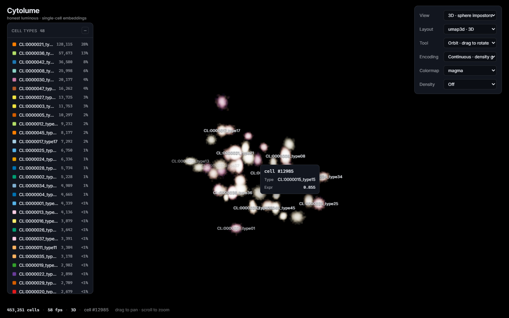
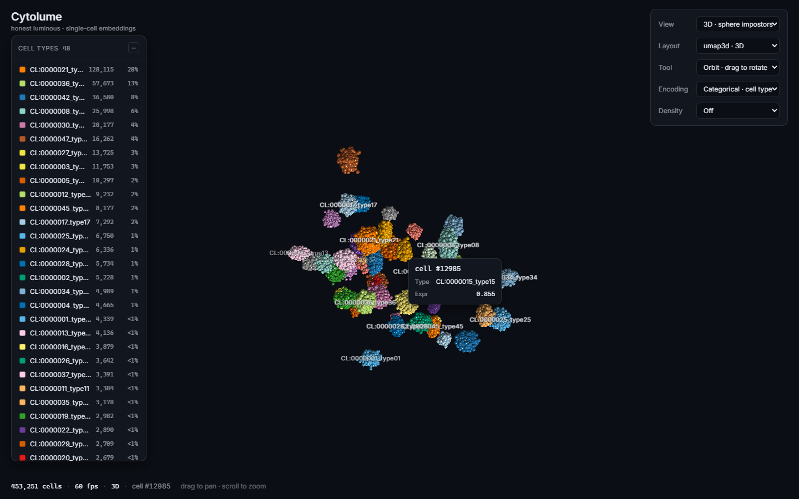
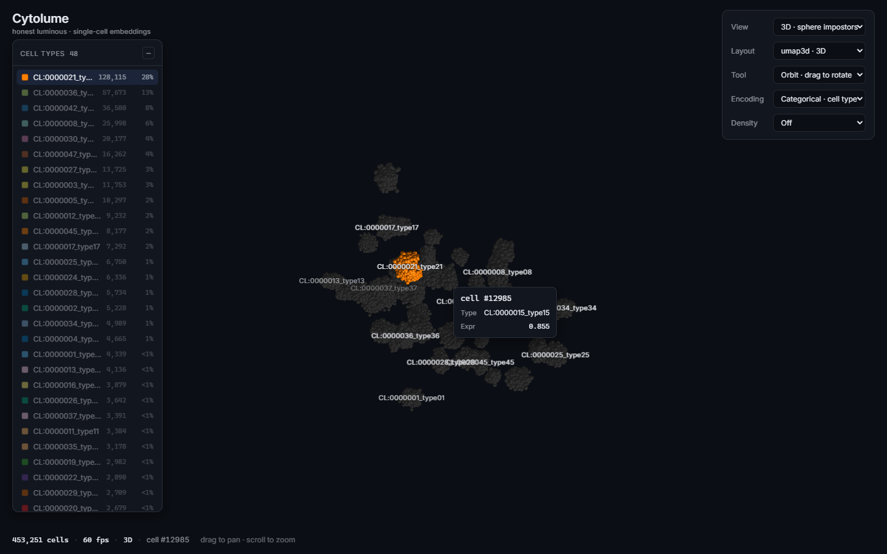
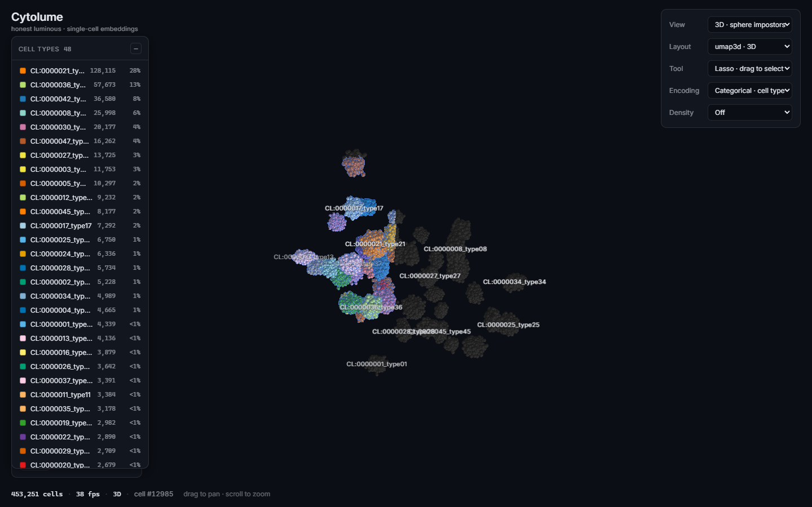
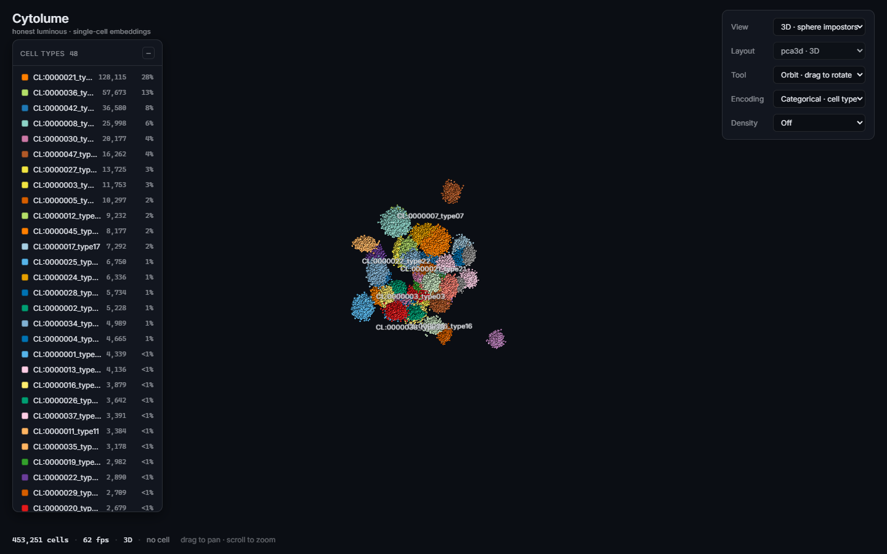
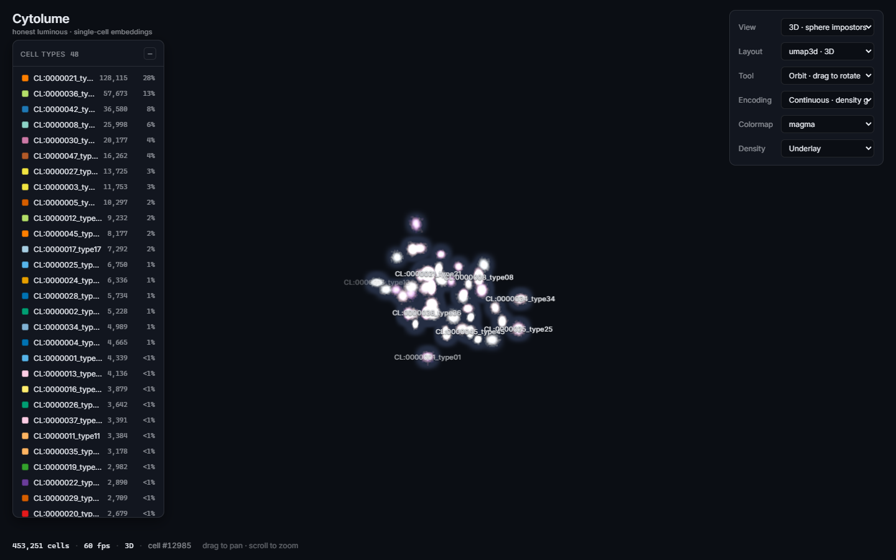

# Cytolume

### Turning a million single cells into an honest, luminous tissue-map you can fly through.



> A GPU-native web library for navigating millions of single-cell embeddings — in
> 2D and 3D, at ~60 fps, with a signature look where **brightness honestly encodes
> density and nothing decorative ever glows.**

*Draft case study — written in the first person; edit freely.*

---

## The problem I started from

The predecessor to this project —
[`cns-iu/hra-cell-embeddings`](https://github.com/cns-iu/hra-cell-embeddings) — set a
deceptively simple job: *visualize ~450,000 single cells in a way a human can actually
read.*

What it shipped was a stack of Jupyter notebooks producing static matplotlib / scanpy
PNGs.
It worked, but it hit every wall that 2D scatter plots of hundreds of thousands of
points hit:

- **The blob.** At a fixed opacity, dense regions saturate into a featureless mass and
  rare cell populations vanish. My own "troubleshooting" notebooks fought overplotting
  by hand, plot after plot.
- **No interaction.** A PNG can't be zoomed, rotated, queried, or recolored. To ask a
  new question you re-ran a cell.
- **No scale headroom.** The Human Reference Atlas is heading toward *millions* of cells
  across ~2,300 cell types and 73 organs. A notebook that strains at 450k is a dead end.

**Cytolume is the interactive successor I always wanted to build** — not "nicer
notebooks," but a packaged, GPU-rendered library that renders the same kind of data
*live*, at scale, with a look I could defend perceptually.

---

## The thesis: *honest luminous*

The reference feeling is Helios-web's emergent glow crossed with a Gaia star-map — but
made rigorous for biology. I gave the project one non-negotiable design rule and built
every pixel around it:

> **Only the data layer emits light. Brightness honestly encodes density. Blending is an
> encoding.**

Three consequences that drove the whole engine:

1. **Density-aware opacity, never fixed alpha.** Per-frame, the renderer recomputes
   per-point opacity from the projected screen density. Fixed global alpha — the exact
   thing that produced the blob in the predecessor — is *banned*.
2. **Blending flips by encoding.** Continuous/density uses **additive** accumulation —
   the buffer carries optical depth in alpha and LUT colour weighted by it, so density and
   value stay separable. Categorical uses **alpha-over / depth**, *never* additive —
   because additively mixing a red cluster and a green cluster invents a yellow "third cell
   type" that doesn't exist.
   *(Updated in `reflection-9`: the accumulation is still additive, but the Reinhard
   tone-map that used to resolve it is gone. It made the per-unit decay rate a function of
   hue, so value and density interacted multiplicatively and the map became many-to-one.
   The resolve now locks lightness to density and hue to value.)*
3. **The chrome is flat.** Panels, borders, and text never glow; a single reserved indigo
   marks interactive state. The only things that emit light are cells.

---

## What I built

Cytolume came together as five verified tracks on top of a data spine. Each one is a
working, adversarially-tested layer — not a mockup.

### 1 · An honest dark scatter, in 2D and 3D

The core renderer puts ~453k cells on a `#0B0E14` canvas as soft sphere sprites (2D) or
**instanced sphere-impostor billboards with per-fragment depth** (3D). Continuous fields
accumulate an optical-depth integral in HDR and resolve so that **lightness carries density
and hue carries cell value**, each with its own 1-D key (`reflection-9`); categorical
clusters get real volume from view-aligned spherical shading and depth occlusion.



### 2 · A named map, not confetti

A 48-type embedding is unreadable as 48 raw hues — past ~24, color stops carrying
meaning. So Cytolume labels each cell-type cluster at its centroid (with declutter and
semantic-zoom), and pairs it with a legend where **hovering a type spotlights it and dims
the rest** — the honest answer to "too many colors."



### 3 · Fluid selection and inspection

Hover any cell for an anchored detail card (id, type, expression). Draw a freeform lasso
to select a cohort — selected cells keep their color and gain an indigo halo while the
rest desaturate into context. Because selections are sets of **stable cell ids**, a
selection *survives an embedding morph*: lasso a cohort in UMAP-3D, fly to t-SNE, and the
same cells stay lit.



### 4 · Embeddings that travel

Switching projections doesn't hard-cut — cells *fly* from their position in one embedding
to the next via a GPU position-morph keyed by cell id, with the camera tilting into the
volume in lockstep. You watch neighborhoods reorganize instead of comparing two static
plots.



### 5 · A density landscape underneath

A screen-space GPU-KDE field (additive splat → Gaussian blur) paints a quiet "terrain"
beneath the cells, with optional iso-density contours and a semantic-zoom blend — pull
back and the soft territories carry the structure; push in and individual cells take over.



---

## Three engineering decisions I'm proud of

**The depth buffer enforces the honest rule.** Porting "additive for density, never for
categories" into 3D looked like a contradiction: additive blending is order-independent
(good — a dense column of cells *should* glow brighter because you see through all of it),
but real 3D wants depth so near clusters occlude far ones. The resolution is clean and,
I think, elegant: **continuous mode runs additive with the depth test off** (a volumetric
emission integral — self-occlusion would *lie* about density), while **categorical mode
runs opaque with the depth test on**. In categorical, the z-buffer becomes a free, exact,
order-independent sort — the nearest sphere wins each pixel, so two saturated categories
are *structurally never blended*. The false-third-color problem isn't policed; it's made
impossible.

**One stable `cell_id` is the universal join.** I designed the data so identity is
decoupled from layout: every embedding is just a coordinate table keyed by the same id.
That single decision makes three features fall out almost for free — GPU morphing between
embeddings (`mix(from, to, t)` by id), depth-correct GPU picking (encode id → color, read
one pixel), and selections that persist across morphs. Most of the "interactive magic" is
really one good invariant.

**Verification-first, by running the real thing.** Every track shipped behind an
*adversarial* check that tries to break it — additive order-independence (render forward
vs. reversed; pixels must match, proving depth is off), a false-third-color test (two
overlapping saturated categories must produce no in-between hue), a lasso re-projection
oracle, a depth-correct pick round-trip. The most instructive bug never showed up in a
type-checker: the 3D cloud once rendered into a tiny corner because the GL viewport was
stale. I found it by driving a headless browser, *reading back the lit pixels*, and seeing
they landed in a 300×150 box — a reminder that "it compiles" and "it works" are different
claims.

---

## Architecture

```
Offline (Python)                         Browser (TypeScript)
─────────────────                        ────────────────────
h5ad / synthetic                         core/   regl 2D renderer  +  raw-WebGL2 3D
  → normalize → PCA                               renderer (sphere impostors, depth,
  → tSNE-2D / UMAP-2D / UMAP-3D                    KDE underlay, picking) + cameras
  → Apache Arrow / Parquet               data/   dependency-free tile loader (.bin/.json)
  → quadtree + octree tiles  ───────►    interaction/ projection · lasso · selection
  → manifest + columns                   labels/ centroids · declutter
                                         ui/     legend · cards · overlays
```

The renderer is **forked, not flagged**: the proven 2D path stays on `regl`/WebGL1, while
the 3D path is hand-written raw WebGL2 — because correct sphere-impostor depth
(`gl_FragDepth`), multiple render targets, and integer textures are core in WebGL2 but
fragile or absent in WebGL1. The browser loader has **zero runtime data dependencies**: it
reads custom quantized `.bin` tiles via `DataView`, never parquet. Recolor, channel-swap,
and embedding-switch are all GPU operations — no geometry rebuilds.

---

## Before / after

| | Predecessor (2024) | Cytolume |
|---|---|---|
| Output | static matplotlib PNGs | interactive WebGL app |
| Dimensions | 2D only | 2D **and** 3D, with morph between |
| Density | fixed-alpha blob | density-aware opacity + KDE terrain |
| Reading 48 types | 48 indistinct hues | labels + focus-one-at-a-time legend |
| Interaction | re-run a notebook cell | orbit · lasso · hover · pick · focus |
| Scale | strained at 450k | 453k at ~60 fps, architected for millions |

---

## Published demo and next steps

The [live showcase](https://muyuhuatang.github.io/Cytolume/) runs a reproducible demo
of **453,251 synthetic cells across 48 example categories**, generated from fixed
random seeds. This provides a repeatable dataset for exploring layouts, selection,
encoding, and figure export. Research datasets can use the same tile contract through
the Python export pipeline; the [integration guide](data-request.md) records the input
fields and provenance needed.

Release `de0642a` completed its GitHub Pages build and deployment on 2026-10-18 (UTC),
and the project owner confirmed the browser check passed. A short Quick start guide
introduces the controls, while the Anatomy panel identifies cell-to-organ links as
**Demo mapping** and shows model download progress. The 22 HRA reference models,
component, scene data, and Inter font are bundled with version and integrity records
and served by the same site. The [deployment workflow](../.github/workflows/deploy-pages.yml) records
the checks every release runs.

Further work includes research-data integration, a WebGPU path, full multi-pass
order-independent transparency, SSAO, and biological "lenses."

Earlier development measurements on an RTX 4060 (ANGLE/D3D11) recorded **453,251 cells
at ~60 fps** orbiting in 3D with the density field live, and a ~286 kB gzipped library
bundle. These measurements describe that development setup.

---

## What this demonstrates

- **GPU / WebGL2 engineering** — hand-written instanced sphere impostors, per-fragment
  depth, HDR tone-mapping, screen-space KDE, GPU picking and position-morphing.
- **Perceptually rigorous data-viz design** — a single defensible thesis carried
  end-to-end, with the hard color/density/occlusion problems solved rather than papered
  over.
- **Large-scale data architecture** — an Arrow/Parquet → quad/octree-tiled → streaming
  pipeline with a dependency-free loader, designed for the jump from 450k to millions.
- **Domain fluency** — single-cell embeddings, the HRA, and the specific failure modes of
  visualizing them.
- **A verification-first process** — adversarial checks and *running the actual app*, not
  just compiling it.

---

*Cytolume · honest luminous · single-cell embeddings.*
